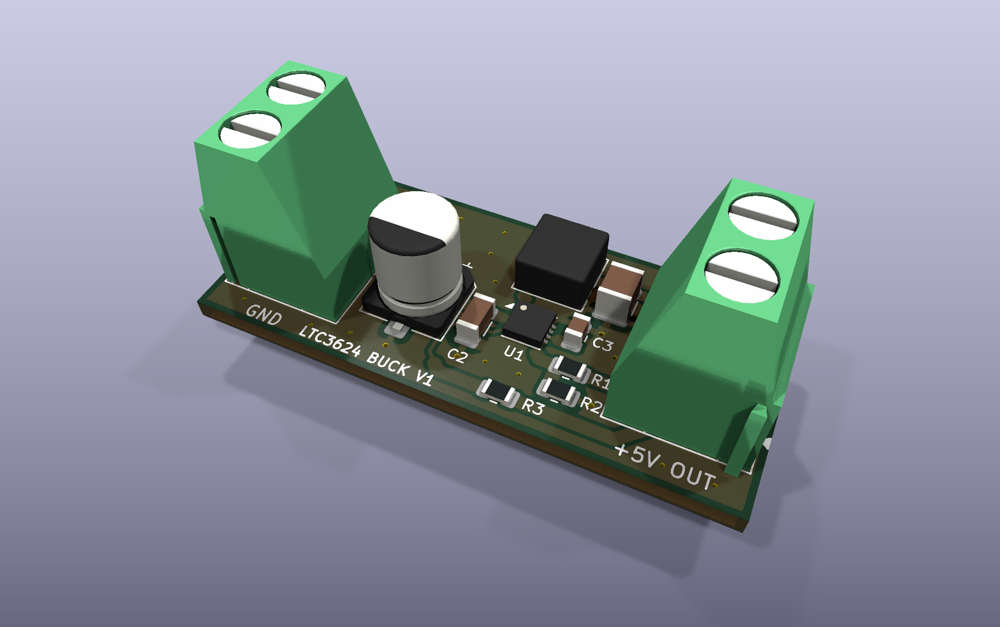
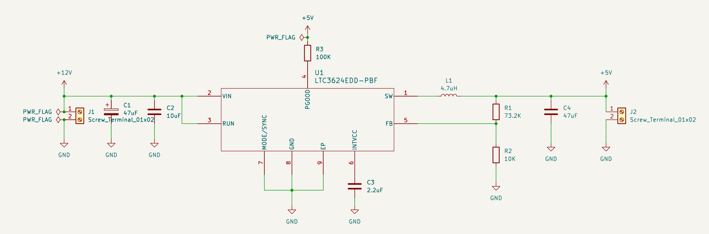
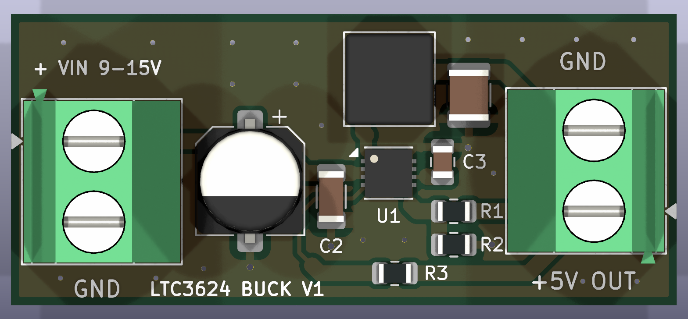
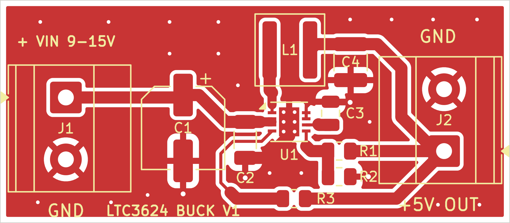

# Adjustable Synchronous Buck Converter

A synchronous buck converter built around the Analog Devices [LTC3624](https://www.analog.com/en/products/ltc3624.html) and designed in KiCad 10. The first version is a fixed 12 V to 5 V, 2 A supply. Later phases turn it into an adjustable supply with a live readout.



## Roadmap

| Phase | Goal | Status |
|---|---|---|
| 1 | Fixed 5 V / 2 A output from a 9 to 15 V input | PCB layout complete, simulation next |
| 2 | Potentiometer-adjustable output, 3 to 10 V | Planned |
| 3 | LCD showing voltage, current, power and temperature | Planned |

## Phase 1

### Specifications

| Parameter | Value |
|---|---|
| Input voltage | 9 to 15 V (12 V nominal) |
| Output | 5.0 V, 2 A max (10 W) |
| Switching frequency | 1 MHz |
| Operating mode | Pulse-skipping, for low output ripple at light load |

### Schematic



### Design highlights

- **Synchronous and monolithic:** the LTC3624 contains both power MOSFETs, so the converter needs only an inductor, capacitors and a feedback divider.
- **Output voltage:** set by R1 = 73.2 kΩ and R2 = 10 kΩ, giving V<sub>OUT</sub> = 0.6 V × (1 + R1/R2) = 4.99 V.
- **Inductor:** 4.7 µH gives about 40% ripple current at the 15 V maximum input. The Coilcraft XAL5030 is rated for 6.7 A, well above the regulator's 3.6 A maximum current limit.
- **Input protection:** the regulator's absolute maximum input is 17 V, close to the 15 V operating maximum. A 47 µF electrolytic capacitor (C1) damps the voltage spike that occurs when a supply is plugged into ceramic input capacitors.

### PCB





- 2 layers, 41.8 × 18.3 mm
- Laid out following the LTC3624 datasheet's layout guidelines: the input capacitor sits right against the VIN pins to keep the high-current switching loop small, the inductor sits directly over the SW pin, and the feedback divider is on the quiet side of the IC away from the switch node.
- All routing is on the top layer. The bottom layer is an unbroken ground plane, tied to a top-layer ground pour with stitching vias.
- Thermal vias under the IC's exposed pad carry heat into the ground plane.

### Bill of materials

| Ref | Value | Package | Part |
|---|---|---|---|
| U1 | LTC3624 buck regulator | DFN-8 3×3 mm | Analog Devices `LTC3624EDD#PBF` |
| L1 | 4.7 µH, 6.7 A saturation | 5.3 × 5.5 mm | Coilcraft `XAL5030-472MEC` |
| C1 | 47 µF 25 V aluminum electrolytic | 6.3 × 7.7 mm SMD | |
| C2 | 10 µF 25 V X7R | 1206 | |
| C3 | 2.2 µF 10 V X7R | 0805 | |
| C4 | 47 µF 16 V X5R/X7R | 1210 | |
| R1 | 73.2 kΩ 1% | 0805 | |
| R2 | 10 kΩ 1% | 0805 | |
| R3 | 100 kΩ (power-good pull-up) | 0805 | |
| J1, J2 | 2-position screw terminal, 5.08 mm | | Phoenix Contact `1715721` |

## Repository structure

```
images/                          Renders and schematic used in this README
Buck_Converter/
  Buck_ConverterV1/
    Buck_ConverterV1.kicad_pro   KiCad project
    Buck_ConverterV1.kicad_sch   Schematic
    Buck_ConverterV1.kicad_pcb   PCB layout
    Buck_ConverterNew.kicad_sym  Project symbol library
    footprints.pretty/           Vendor LTC3624 footprints
```

## References

- [LTC3624 datasheet](https://www.analog.com/media/en/technical-documentation/data-sheets/36242fd.pdf)
- [Coilcraft XAL50xx inductor datasheet](https://www.coilcraft.com/getmedia/49bc46c8-4b2c-45b9-9b6c-2eaa235ea698/xal50xx.pdf)
